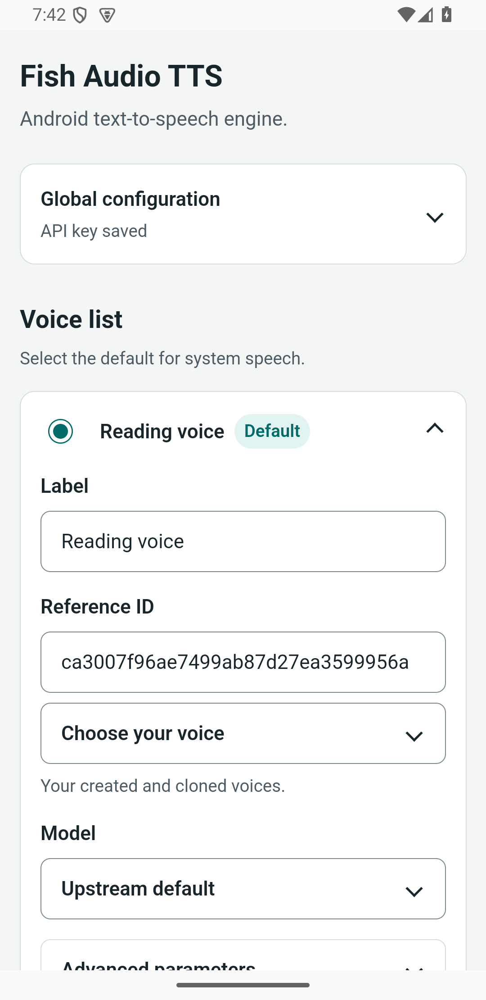
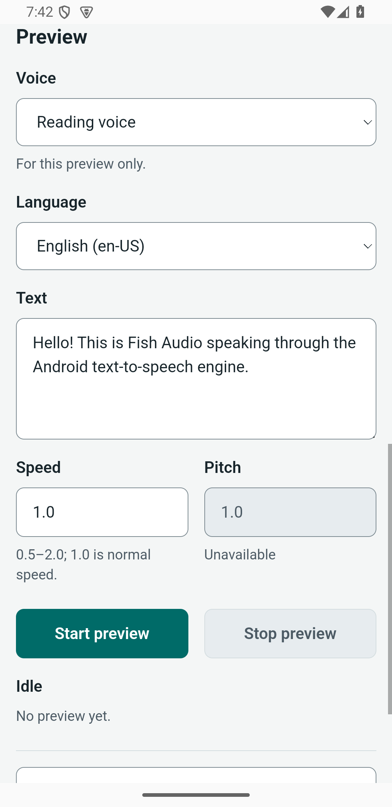
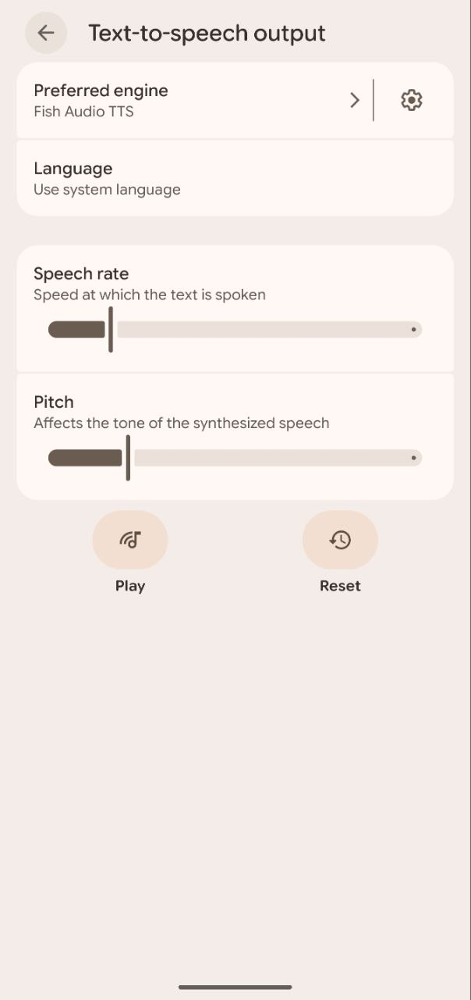

# Fish Audio TTS for Android

**Fish Audio TTS is an independent, unofficial client and is not affiliated with, endorsed by, or sponsored by Fish Audio.**

Use Fish Audio voices in reading apps and other apps that support Android system text-to-speech. The English settings panel lets you manage voices and try them before reading.

Requires Android 7.0+, an internet connection, and your own [Fish Audio API key](https://fish.audio/app/api-keys) with sufficient credits.

## Quick start

1. Install the APK and open **Fish Audio TTS**.
2. Expand **Global configuration**, enter your key and press **Save API key**.
3. Press **Add voice**, choose one of your voices or enter a **Reference ID**, then **Save voice**.
4. Select the radio beside a saved voice to make it the default. Use **Preview** to try it.
5. Press **Open system TTS settings**, choose **Fish Audio TTS**, then select Android system TTS in your reading app.

The engine works with the panel closed. Your key is encrypted in native Android storage; speech text goes directly to Fish Audio. An internet connection is required for synthesis.

## Screenshots

  
  
  

## License

[Apache-2.0](LICENSE). Third-party license texts are bundled in the APK and available offline under **Open source licenses**. Fish Audio services and voices have their own terms.

[User guide](docs/usage.md) · [Build and development](docs/development.md) · [Verification](docs/verification.md)
